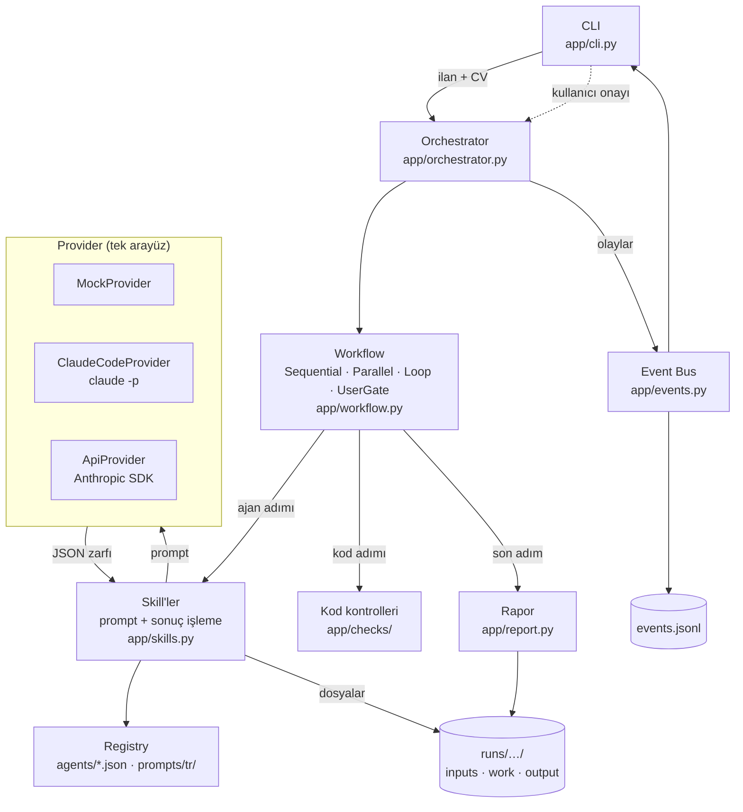

# career-crew

**CV'nize olmayan bir şey eklemeyen çok ajanlı iş başvurusu asistanı.**

  

Bir iş ilanı ve CV'nizi verirsiniz. Altı yapay zekâ ajanı kendi aralarında konuşarak şunları hazırlar:

- 📄 **İlana göre uyarlanmış CV**
- 💌 **Ön yazı**
- 🎤 **İlana ve CV'ye özel mülakat hazırlığı**
- 📊 **Rapor:** işveren puanı, ATS skoru (önce/sonra), yapılan değişiklikler, açık eksikler

Ajanların konuşması terminalde canlı akar. Kim neyi neden değiştirdi, görürsünüz.

## İçindekiler

- [Neden farklı?](#neden-farklı)
- [Hızlı başlangıç](#hızlı-başlangıç)
- [Örnek çalıştırma](#örnek-çalıştırma)
- [Nasıl çalışır?](#nasıl-çalışır)
- [Mimari](#mimari)
- [Modlar](#modlar)
- [Gizlilik](#gizlilik)
- [Geliştirme](#geliştirme)
- [Yol haritası](#yol-haritası)

## Neden farklı?

Yapay zekâyla CV uyarlamanın bilinen sorunu uydurmadır. Model, ilana uysun diye adayda olmayan beceriyi, rakamı ya da kıdemi ekler. Araştırmalar bunun en çok deneyim bölümünde olduğunu gösteriyor ([Grounded Optimization, arXiv 2607.01457](https://arxiv.org/abs/2607.01457)). Uydurma mülakatta ortaya çıkar ve adaya zarar verir.

career-crew bu sorunu modelin iyi niyetine bırakmaz:

| | Yaygın yaklaşım | career-crew |
|---|---|---|
| **Uydurmaya karşı** | Prompta "uydurma yapma" yazılır, modele güvenilir | Her madde orijinal CV'den birebir bir alıntıya bağlanır. Alıntıyı ve 8 ayrı kuralı **kod** kontrol eder |
| **Son karar** | Ajanlar birbirini onaylar | Kod hata bulduysa Doğrulayıcı ajan onay **veremez**. Onay verirse kod kararı "ret" yapar |
| **Eksik beceriler** | Eksik anahtar kelimeyi CV'ye eklemek önerilir | Eksikler eklenmez. Raporda "gerçek eksik" diye yazılır, mülakat hazırlığında dürüst cevap önerilir |
| **ATS skoru** | Tek bir sayı | Önce/sonra skoru ve hangi kelimenin neden eklenmediği |
| **Şeffaflık** | Sadece sonuç dosyası | Ajanların konuşması canlı akar, her tur `work/` klasöründe saklanır, tüm süreç `events.jsonl` dosyasına yazılır |
| **Gereksiz tur** | Sabit sayıda yeniden yazma | Hedefe ulaşınca ya da puan artmayınca döngü durur |
| **Veri** | CV bir bulut hizmetine yüklenir | Her şey kendi bilgisayarınızda çalışır. Veri yalnızca seçtiğiniz model sağlayıcısına gider, analitik yok |
| **Maliyet** | Aylık ücretli hizmet | `mock` modu ücretsiz. `claude-code` modu mevcut Claude aboneliğinizi kullanır |

Bir gerçek çalıştırmadan: ilan Docker istiyordu, CV'de Docker yoktu. CV Yazarı Docker'ı eklemedi. İşe Alım Müdürü bu yüzden 62 puan verdi ve döngü puanı yükseltmek için uydurmaya başvurmadı. Ön yazı Docker deneyimi olmadığını açıkça söyledi, mülakat hazırlığı bu soru için dürüst bir cevap önerdi.

## Hızlı başlangıç

Python 3.11 ya da üstü gerekir.

```bash
git clone https://github.com/<kullanici>/career-crew.git
cd career-crew
python3 -m venv .venv
source .venv/bin/activate
pip install -e ".[api,dev]"
```

Hesap gerektirmeyen demo (sahte CV ve ilan ile):

```bash
career-crew --ilan examples/ilan.md --cv examples/cv.md
```

Kendi dosyalarınızla:

```bash
career-crew --ilan ilan.md --cv cv.md --mod api
```

| Seçenek | Açıklama |
|---|---|
| `--ilan` | İş ilanı (`.md` ya da `.txt`) |
| `--cv` | CV (`.md` ya da `.txt`) |
| `--mod` | `mock` (varsayılan), `claude-code` ya da `api` |
| `--runs` | Çalıştırma klasörlerinin yeri (varsayılan `runs/`) |
| `--evet` | İlan okuma onayını sorma |
| `--hizli` | `mock` modunda bekleme yapma |

## Örnek çalıştırma

`mock` modunda CV Yazarı ilk turda bilerek uydurma ekler. Kontrollerin nasıl çalıştığını gösterir:

```
───────────────────────────────── CV turu 1/3 ──────────────────────────────────
✍️ CV Yazarı: CV uyarlandı → output/cv.md. Backend becerileri özete ve beceri
listesinin başına alındı.
🧮 Kod kontrolü: 5 sorun: ATS %30.8 → %38.5
   ✗ Kanıt orijinal CV'de bulunamadı: 'PostgreSQL sorgu optimizasyonunu yönettim.'
   ✗ Kanıt orijinal CV'de bulunamadı: 'Docker ile servisleri paketledim.'
   ✗ 'Docker' ilanda var ama orijinal CV'de yok (sızıntı).
   ✗ '5 yıl' iddiası orijinal CV ile uyuşmuyor (en fazla 3 yıl).
   ✗ '40' rakamı orijinal CV'de yok.
🛡️ Doğrulayıcı: Ret: Docker, %40 ve 5 yıl uydurma. 'Yer aldım' ifadesi
'yönettim' yapılmış.
👔 İşe Alım Müdürü: Puan 72. Uydurmalar mülakatta ortaya çıkar, SQL görünmüyor,
test deneyimi zayıf anlatılmış.
───────────────────────────────── CV turu 2/3 ──────────────────────────────────
✍️ CV Yazarı: Düzeltildi. Docker, %40 ve 'yönettim' çıkarıldı, özet orijinal 3
yıla döndü. SQL, orijinal optimizasyon maddesinden öne çıkarıldı.
🧮 Kod kontrolü: Sorun yok. ATS %30.8 → %38.5
🛡️ Doğrulayıcı: Onay.
👔 İşe Alım Müdürü: Puan 84. Docker ve Kubernetes gerçek eksik, ölçülebilir
sonuç yok.
✓ CV 2. turda hedefe ulaştı.
```

Her çalıştırma `runs/` altında kendi klasörünü açar:

```
runs/2026-11-21_143000_ilan/
├── inputs/       ilan ve CV kopyası
├── work/         job.json, claims.json, her turun CV'si
├── output/       cv.md, cover_letter.md, interview.md, report.md
└── events.jsonl  tüm konuşma
```

## Nasıl çalışır?

### Ajanlar

| Ajan | Görev | Model |
|---|---|---|
| 🔎 İlan Analisti | İlandan beceri ve anahtar kelimeleri çıkarır | Sonnet |
| ✍️ CV Yazarı | CV'yi uyarlar, her maddeyi kanıta bağlar | Sonnet |
| 🛡️ Doğrulayıcı | Uydurma olup olmadığına karar verir | Sonnet |
| 👔 İşe Alım Müdürü | 0-100 puan verir, en kritik 3 eksiği söyler | Haiku |
| 💌 Mektup Yazarı | Ön yazı hazırlar | Sonnet |
| 🎤 Mülakatçı | Mülakat soruları ve cevap ipuçları hazırlar | Haiku |

Modeller `agents/*.json` dosyalarından değiştirilebilir. Promptlar `prompts/tr/` altındadır. Ajanlar kısa konuşur: en fazla 3 cümle, önce karar sonra gerekçe, selamlama ve övgü yok.

### Akış

```
İlan analizi → kullanıcı onayı → CV döngüsü (en fazla 3 tur) → ön yazı → mülakat → rapor
                                  │
                                  ├─ CV Yazarı
                                  ├─ kod kontrolleri
                                  └─ Doğrulayıcı + İşe Alım Müdürü (paralel)
```

Döngü üç durumda biter:

1. **Hedefe ulaşıldı:** uydurma yok ve puan 80 ya da üstü.
2. **Puan artmıyor:** üst üste iki temiz turda puan yükselmedi. Kalan eksikler orijinal CV'de olmadığı için yeni tur yalnızca token harcar.
3. **3 tur doldu:** en iyi sürüm kullanılır ve rapora uyarı eklenir.

### Uydurmaya karşı üç katman

1. **Kanıt alıntısı (kod):** CV Yazarı her maddeyi orijinal CV'den en az 3 kelimelik birebir bir alıntıya bağlar. Kod, alıntının orijinal CV'de gerçekten geçtiğini ve CV'deki her maddenin bir alıntıya bağlı olduğunu kontrol eder.
2. **Deterministik kontroller (kod):** aşağıdaki tablodaki kurallar. LLM kullanılmaz, aynı girdi her zaman aynı sonucu verir.
3. **Doğrulayıcı ajan (LLM):** kodun yakalayamadığı anlam büyütmelerini yakalar ("yer aldım" → "yönettim"). Kod hatası varken onay veremez.

| Kontrol | Düzey | Ne yakalar |
|---|---|---|
| `coverage` | hata | Kanıta bağlanmamış CV maddesi |
| `evidence` | hata | Orijinal CV'de olmayan ya da 3 kelimeden kısa kanıt alıntısı |
| `leakage` | hata | İlanda olup orijinal CV'de olmayan beceri |
| `leakage` (yeni terim) | uyarı | İlanda da orijinal CV'de de olmayan teknoloji adı |
| `dates` | hata | Yeni yıllar, şişirilmiş "N yıl deneyim" |
| `numbers` | hata | Yeni rakam ve yüzdeler |
| `titles` | hata | Eklenen kıdem ya da unvan ifadesi |
| `structure` | uyarı | 2 sayfayı aşan uzunluk, kaybolan bölüm |
| `ats` | skor | İlan anahtar kelimelerinin CV'de geçme oranı |

## Mimari



**Temel kararlar:**

- **Ajanlar araç kullanmaz.** İlan, CV ve önceki sürüm prompta doğrudan eklenir. Her ajan tek bir JSON zarfı döndürür: `{"message", "data", "files"}`. Dosyaları ajan değil orchestrator yazar ve her skill yalnızca kendi dosya adlarını yazabilir. Bu yüzden üç mod aynı biçimde çalışır, `claude-code` modunda da ajanların dosya ya da shell erişimi yoktur.
- **Workflow alana bağımlı değildir.** `Sequential`, `Parallel`, `Loop` ve `UserGate` yalnızca bir bağlam nesnesiyle konuşur. Kariyer akışı bu parçalarla [orchestrator.py](app/orchestrator.py) içinde kurulur.
- **Kontroller LLM kullanmaz.** `app/checks/` içindeki her modül saf bir Python fonksiyonudur.
- **Her şey olay olarak akar.** Terminal çıktısı ve `events.jsonl` aynı Event Bus'tan beslenir. M2'deki web arayüzü aynı olayları SSE ile alacak.

**Görev durumları** (A2A'dan uyarlandı): `submitted → working → completed / rejected / failed / input-required`.

| Yol | Görev |
|---|---|
| `app/cli.py` | Argümanlar, renkli canlı akış, ilan okuma onayı |
| `app/orchestrator.py` | Kariyer akışını kurar, çalıştırma klasörünü açar, en iyi turu seçer |
| `app/workflow.py` | Akış yapı taşları: `Sequential`, `Parallel`, `Loop`, `CodeStep`, `UserGate` |
| `app/skills.py` | Skill başına prompt üretimi, yanıt doğrulama ve durum güncellemesi |
| `app/tasks.py` | `Task`, `Message`, `TextPart`, `FilePart`, `DataPart`, `Artifact` |
| `app/events.py` | Event Bus ve `events.jsonl` kaydı |
| `app/registry.py` | Agent Card'ları ve promptları yükler |
| `app/providers/` | `mock`, `claude_code`, `api` ve ortak JSON zarfı ayrıştırıcısı |
| `app/checks/` | `coverage`, `evidence`, `leakage`, `dates`, `numbers`, `titles`, `structure`, `ats` |
| `app/report.py` | `report.md`: skorlar, turlar, açık sorunlar, değişiklikler |
| `agents/` | 6 Agent Card: model, efor, renk, prompt dosyası |
| `prompts/tr/` | Türkçe rol promptları ve ortak konuşma sözleşmesi |

## Modlar

| Mod | Kim için | Maliyet |
|---|---|---|
| `api` | **Önerilen yol.** Kendi Anthropic API anahtarınızla | Kendi API kullanımınız |
| `claude-code` | Kendi Claude Pro/Max aboneliğinizle kişisel kullanım | Ek ücret yok, abonelik limitine tabi |
| `mock` | Demo ve geliştirme | Ücretsiz |

**`api` modu:** `ANTHROPIC_API_KEY` ortam değişkenini ayarlayın ya da `.env.example` dosyasını `.env` olarak kopyalayıp anahtarı yazın. Anahtar koda ya da loglara yazılmaz.

**`claude-code` modu:** Claude Code kurulu ve giriş yapılmış olmalı (`claude auth login`). Ajanlar global ayarlarınız, eklentileriniz, hook'larınız ve MCP sunucularınız olmadan çalışır, hiçbir araca erişimleri yoktur. Ortamda `ANTHROPIC_API_KEY` varsa bu mod onu kaldırır, böylece ücret API'ye değil aboneliğe yansır. Bir çalıştırma yaklaşık 2 dakika sürer.

> **Kullanım şartları:** `claude-code` modu, herkesin **kendi** aboneliğiyle **kendi** bilgisayarında kişisel kullanımı içindir. Proje bir hizmet olarak sunulmaz. Claude Code giriş bilgileri asla okunmaz ya da başka bir yere taşınmaz, yalnızca resmî `claude` komutu çağrılır. Bu modu kullananlar Anthropic kullanım şartlarına kendileri uymakla yükümlüdür.

## Gizlilik

- `runs/`, `memory/` ve `.env` `.gitignore`'dadır. Repoda yalnızca **sahte** örnek CV ve ilan vardır.
- Veriler, seçilen model sağlayıcısı dışında hiçbir yere gönderilmez. Analitik ya da izleme yoktur.

## Geliştirme

```bash
pytest
```

Gerçek model çağıran testler (`claude-code` girişi gerekir):

```bash
CAREER_CREW_LIVE=1 pytest -m live
```

Canlı testler, ajan çağrısının kullanıcı eklentilerini ve MCP sunucularını yüklemediğini ve hiçbir araca erişmediğini doğrular.

Tasarım dokümanı: [KARIYER-EKIBI.md](KARIYER-EKIBI.md)

## Yol haritası

- [x] **M1:** çekirdek, terminal arayüzü, uydurma kontrolleri
- [ ] **M2:** localhost web arayüzü, PDF/fotoğraf girdisi, İngilizce promptlar
- [ ] **M3:** hafıza, duraklat/devam et, PDF çıktı
- [ ] **M4:** replay modu, demo GIF'i

## Esinlenmeler

| Kaynak | Ne alındı |
|---|---|
| [DeepLearning.AI: Multi AI Agent Systems with crewAI](https://learn.deeplearning.ai/courses/multi-ai-agent-systems-with-crewai/lesson/a8ecj/build-a-crew-to-tailor-job-applications) | İş başvurusu ekibi rolleri |
| [Grounded Optimization, arXiv 2607.01457](https://arxiv.org/abs/2607.01457) | Uydurmanın deneyim bölümünde yoğunlaşması, tarih kontrolü, deterministik sızıntı tespiti |
| [Hirepanel](https://github.com/punit2911/Hirepanel) | "Her iddia doğrulanmış bir alıntıya dayanmalı" ilkesi |
| Yusuf Baykaloğlu, *Çoklu-Ajan Sistemleri: A2A Protokolü ile AI Agent Orkestrasyonu* | Agent Card, Task durumları, Message/Part, workflow desenleri, Event Bus |

## Uyarı

Yapay zekâ çıktıları hatalı olabilir. Başvurmadan önce her şeyi kendiniz kontrol edin.

## Lisans

[MIT](LICENSE)
