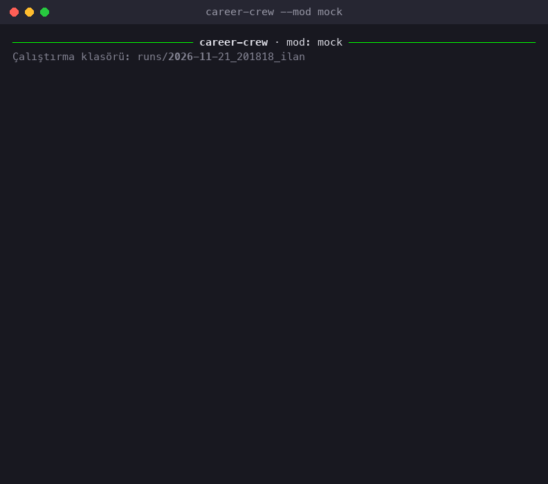
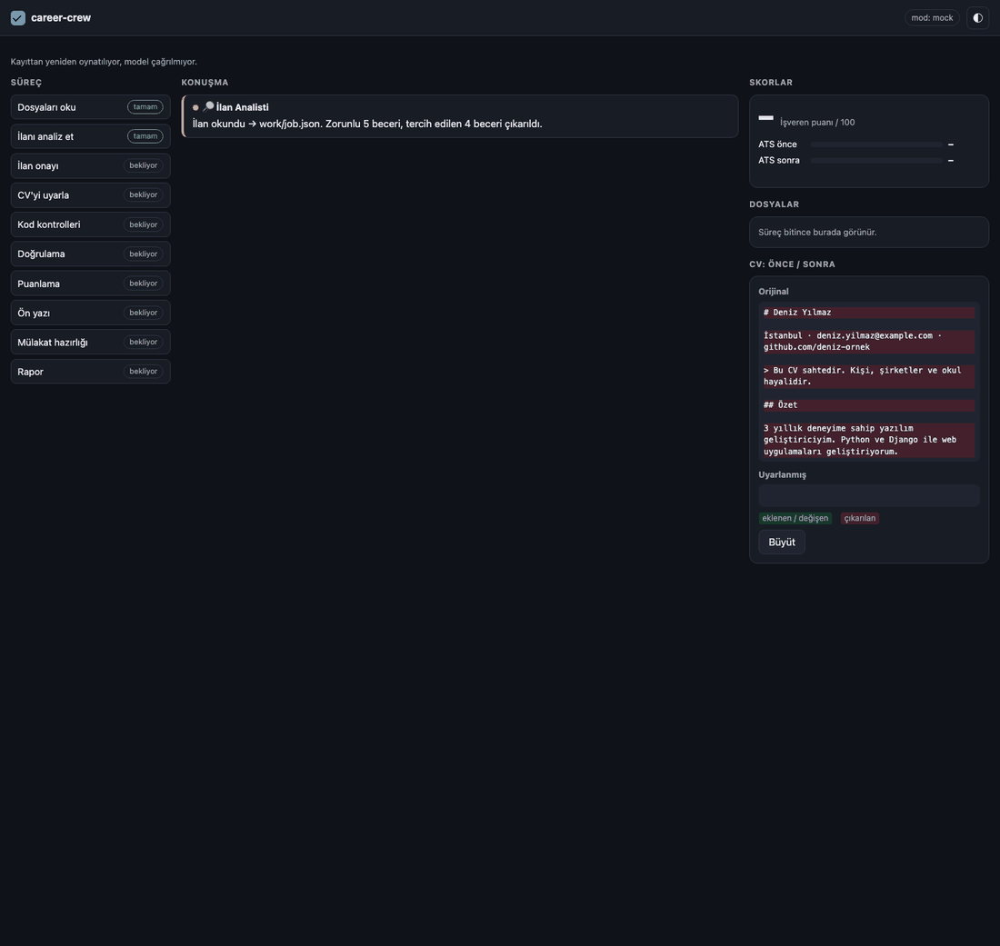
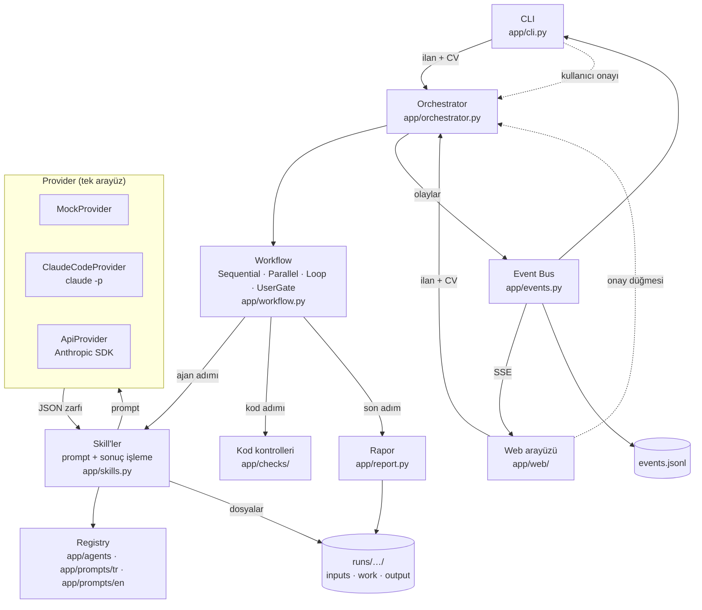

# career-crew

İlana göre CV uyarlayan, ama CV'de olmayan hiçbir şeyi eklemeyen bir iş başvurusu asistanı.

[](https://github.com/burakaydins/career-crew/actions/workflows/tests.yml)  



Aynı çalıştırma web arayüzünde:



Kendi iş başvurularım için yazdım. İlanı ve CV'yi veriyorsunuz, altı ajan sırayla çalışıp ilana göre düzenlenmiş bir CV, ön yazı, mülakat hazırlığı ve bir rapor çıkarıyor. Raporda işveren puanı, ATS skorunun önceki ve sonraki hâli, CV'de nelerin değiştiği ve kapanmayan eksikler var. Ajanların birbirine yazdıkları terminalde ya da yerel bir web sayfasında canlı akıyor, hangi maddenin neden değiştiğini oradan takip edebiliyorsunuz.

## İçindekiler

- [Neden farklı?](#neden-farklı)
- [Hızlı başlangıç](#hızlı-başlangıç)
- [Web arayüzü](#web-arayüzü)
- [Replay](#replay)
- [Deneme mülakatı](#deneme-mülakatı)
- [Hafıza](#hafıza)
- [Duraklatma ve devam etme](#duraklatma-ve-devam-etme)
- [PDF çıktı](#pdf-çıktı)
- [Örnek çalıştırma](#örnek-çalıştırma)
- [Nasıl çalışır?](#nasıl-çalışır)
- [Mimari](#mimari)
- [Modlar](#modlar)
- [Diller](#diller)
- [Görsel ve taranmış PDF girdisi](#görsel-ve-taranmış-pdf-girdisi)
- [Gizlilik](#gizlilik)
- [Geliştirme](#geliştirme)
- [Yol haritası](#yol-haritası)

## Neden farklı?

Yapay zekâya CV uyarlattığınızda ilana uysun diye adayda olmayan beceri, rakam ya da kıdem ekleyebiliyor ([Grounded Optimization, arXiv 2607.01457](https://arxiv.org/abs/2607.01457) bu tür hataları sınıflandırıyor). Mülakatta sorulduğunda da ortaya çıkıyor.

Promptta "uydurma yapma" demek bunu engellemiyor. career-crew'da her CV maddesi orijinal CV'den birebir bir alıntıya bağlanıyor ve bu bağlantıyı model değil kod kontrol ediyor:

| | Yaygın yaklaşım | career-crew |
|---|---|---|
| Uydurmaya karşı | Prompta "uydurma yapma" yazılır, modele güvenilir | Her madde orijinal CV'den bir alıntıya bağlanır. Alıntıyı ve 8 ayrı kuralı kod kontrol eder |
| Son karar | Ajanlar birbirini onaylar | Kod hata bulduysa Doğrulayıcı onay veremez. Verirse kod kararı "ret" olarak değiştirir |
| Eksik beceriler | Eksik anahtar kelimeyi CV'ye eklemek önerilir | Eksik kelime eklenmez. Raporda gerçek eksik olarak yazılır, mülakat hazırlığında nasıl dürüstçe cevaplanacağı anlatılır |
| ATS skoru | Tek bir sayı | Önceki ve sonraki skor, eksik kelimeler ve neden eklenmedikleri |
| Şeffaflık | Sadece sonuç dosyası | Konuşma canlı akar, her turun CV'si `work/` klasöründe kalır, süreç `events.jsonl` dosyasına yazılır |
| Tur sayısı | Sabit sayıda yeniden yazma | Hedefe ulaşınca ya da puan artmayı bırakınca döngü durur |
| Veri | CV bir bulut hizmetine yüklenir | Program kendi bilgisayarınızda çalışır. Veri sadece seçtiğiniz model sağlayıcısına gider, analitik yok |
| Maliyet | Aylık ücretli hizmet | `mock` modu ücretsiz, `claude-code` modu mevcut Claude aboneliğinizle çalışır |

Gerçek bir çalıştırmada ilan Docker istiyordu ve CV'de Docker yoktu. CV Yazarı Docker'ı eklemedi, İşe Alım Müdürü de bu yüzden 62 puan verdi. Ön yazıda Docker deneyimi olmadığı açıkça yazıyordu, mülakat hazırlığında da "Docker kullandınız mı?" sorusu için dürüst bir cevap önerisi vardı.

## Hızlı başlangıç

Python 3.11 ya da üstü gerekiyor.

```bash
git clone https://github.com/burakaydins/career-crew.git
cd career-crew
python3 -m venv .venv
source .venv/bin/activate
pip install -e ".[api,dev]"
```

Hesap gerektirmeyen demo, sahte bir CV ve ilanla:

```bash
career-crew --ilan examples/ilan.md --cv examples/cv.md
```

Kendi dosyalarınızla:

```bash
career-crew --ilan ilan.pdf --cv cv.docx --mod api
```

CV ve ilan `.md`, `.txt`, `.pdf` ya da `.docx` olabilir. İlanın ekran görüntüsü (`.png`, `.jpg`) ve taranmış PDF de verilebilir, [aşağıda](#görsel-ve-taranmış-pdf-girdisi) anlattım. PDF, DOCX ve görsellerden çıkarılan metin, ajanların ve kontrollerin tam olarak neyi gördüğü bilinsin diye çalıştırma klasöründe `inputs/cv_metin.md` olarak saklanıyor.

Tarayıcıda kullanmak isterseniz:

```bash
career-crew web
```

Bitmiş bir çalıştırmayı yeniden oynatmak ya da CV'nize göre deneme mülakatı yapmak için [Replay](#replay) ve [Deneme mülakatı](#deneme-mülakatı) bölümlerine bakın.

| Seçenek | Açıklama |
|---|---|
| `--ilan` | İş ilanı (`.md`, `.txt`, `.pdf`, `.docx`, `.png`, `.jpg`) |
| `--cv` | CV (aynı türler) |
| `--mod` | `mock` (varsayılan), `claude-code` ya da `api` |
| `--dil` | Ajan promptlarının dili: `tr` (varsayılan) ya da `en` |
| `--runs` | Çalıştırma klasörlerinin yeri (varsayılan `runs/`) |
| `--evet` | İlan okuma onayını sorma (ders onayını atlamaz) |
| `--pdf` | CV ve ön yazıyı PDF olarak da üret |
| `--devam` | Duraklayan ya da yarıda kalan çalıştırmayı sürdür, değeri çalıştırma klasörü |
| `--hafiza` | Derslerin tutulduğu klasör (varsayılan `memory/`) |
| `--hizli` | `mock` modunda bekleme yapma |

## Web arayüzü

```bash
career-crew web
```

Komut `http://127.0.0.1:8765` adresinde bir sayfa açıyor ve tarayıcıyı da açıyor. Üç sütunu var (yukarıdaki GIF, `docs/web.png` dosyasında da son hâli var). Solda süreç adımları ve durumları, ortada ajanların canlı konuşması, sağda skorlar, çıktı dosyaları ve orijinal CV ile uyarlanmış CV'nin karşılaştırması (eklenen satırlar yeşil, çıkarılanlar kırmızı, "Büyüt" ile iki CV yan yana açılıyor). İlan okuma onayı terminaldeki soru yerine konuşmanın içinde bir düğme olarak çıkıyor: onaylayabilir ya da ne düzeltileceğini yazabilirsiniz. Açık ve koyu tema var, telefon genişliğinde sütunlar alt alta diziliyor.

İlanı ve CV'yi sürükleyip bırakabilir ya da metin olarak yapıştırabilirsiniz. Dosya türü ve 10 MB sınırı hem tarayıcıda hem sunucuda denetleniyor. Sayfa adresindeki `#run=...` kısmı sayesinde sekmeyi yenileseniz de süreç baştan oynatılıyor. Açılış sayfasındaki "Geçmiş çalıştırmalar" listesinde her kayıt için "yeniden oynat" ve "mülakat yap" düğmeleri var.

| Seçenek | Açıklama |
|---|---|
| `--port` | Port (varsayılan `8765`) |
| `--mod` | Model sağlayıcısı. Web arayüzünde sunucuyu başlatırken seçiliyor |
| `--dil` | Varsayılan prompt dili, sayfadan değiştirilebiliyor |
| `--runs` | Çalıştırma klasörlerinin yeri |
| `--hizli` | `mock` modunda bekleme yapma |
| `--acma` | Tarayıcıyı kendiliğinden açma |

Sunucu yalnızca `127.0.0.1` adresini dinliyor, başka adres seçeneği yok. Bunun üstüne iki kontrol daha koydum. Host başlığı `127.0.0.1` ya da `localhost` değilse istek reddediliyor (DNS rebinding'e karşı). Yazma istekleri başka bir sitenin sayfasından gelmişse, yani Origin başlığı bu sunucunun adresi değilse, reddediliyor. Yine de bir ağ servisi olarak tasarlanmadı: kimlik doğrulaması yok, aynı anda tek süreç çalışıyor.

Arayüz düz HTML, CSS ve JavaScript. Derleme adımı ve CDN yok, `app/web/static/` altındaki üç dosyadan ibaret. Olaylar terminaldeki ile aynı Event Bus'tan geliyor, tarayıcıya SSE ile akıyor. Süreç arka plandaki bir iş parçacığında çalışıyor, orchestrator'ın mantığı web için kopyalanmadı.

## Replay

Her çalıştırmanın olayları `events.jsonl` dosyasına yazılıyor. Bu dosyadan bitmiş bir çalıştırmayı, canlı akıyormuş gibi yeniden oynatabiliyorsunuz. Model çağrılmıyor, hesap ya da limit harcanmıyor:

```bash
career-crew replay runs/2026-11-22_153000_ilan
career-crew replay runs/2026-11-22_153000_ilan --hiz 2
career-crew replay runs/2026-11-22_153000_ilan --aninda
```

Terminalde canlı çalıştırmayla aynı `Renderer` kullanılıyor, yani ekranda göreceğiniz şey aynı. Olaylar arasındaki bekleme özgün zamanlamaya göre, ama modelin düşündüğü uzun boşluklar 1,5 saniyeye kısalıyor. `--hiz 2` süreyi yarıya indiriyor, `--aninda` beklemeden hepsini yazıyor. Klasörde `events.jsonl` yoksa ya da bozuksa hangi satırda ne olduğunu söyleyen bir hata veriyor.

Web arayüzünde aynı oynatma açılış sayfasından başlıyor ve konuşma, adımlar, skorlar ve CV karşılaştırması canlı bir çalıştırmadaki gibi doluyor. Hız menüsü var. `/?replay=<klasör>&adim=N` adresi ilk N olayı hemen gösteriyor, README'deki GIF'in kareleri böyle alındı.

## Deneme mülakatı

```bash
career-crew mulakat runs/2026-11-22_153000_ilan --mod claude-code
career-crew mulakat runs/2026-11-22_153000_ilan --betik --soru 4
```

Mülakatçı, çalıştırmanın `output/interview.md` dosyasındaki soruları sırayla soruyor (dosya yoksa soruları yeniden üretiyor), siz terminalde cevap yazıyorsunuz, o da cevabı orijinal CV'nize ve ilana göre değerlendiriyor. Soru sayısı `--soru` ile ayarlanıyor (varsayılan 5, en fazla 10). Boş bırakırsanız soru geçiliyor, `/bitir` yazarsanız mülakat bitiyor.

Değerlendirmede asıl baktığı şey, cevapta CV'de olmayan bir deneyim, beceri, unvan ya da rakam iddiası olup olmadığı. Varsa iddiayı işaretliyor ve aynı konuyu CV'deki gerçek deneyimle ya da bir öğrenme planıyla nasıl anlatabileceğinizi öneriyor. Uydurma önermiyor. Bunun için kodda iki yedek var: cevaptaki, CV'de geçmeyen rakamlar model görmese bile "doğrula" uyarısıyla gösteriliyor, önerilen çerçevede CV'de olmayan bir rakam varsa öneri gösterilmiyor.

Sonunda `output/mulakat_geri_bildirim.md` yazılıyor: güçlü cevaplar, geliştirilecek cevaplar, CV'de olmayan iddialar ve her cevabın değerlendirmesi. Limit dolarsa ya da yarıda keserseniz o ana kadarki cevapların geri bildirimi yine yazılıyor. Mülakat çalıştırmanın `state.json` ve `events.jsonl` dosyalarına dokunmuyor, kendi kaydı `work/interview_events.jsonl` içinde.

`--betik` ile `mock` sağlayıcısı hazır cevapları kullanıyor (biri bilerek uydurma rakam içeriyor), demo ve testler böyle çalışıyor. `mock` değerlendirmeleri de hazır, yani yazdığınız cevaba göre değişmiyor. Gerçek değerlendirme için `claude-code` ya da `api` gerekiyor. Terminal etkileşimli değilse ve `mock` seçili değilse komut bunu söyleyip duruyor.

Web arayüzünde geçmiş çalıştırmalar listesindeki "mülakat yap" düğmesi sohbet benzeri bir sayfa açıyor. Mülakatçı soruyu yazıyor, siz cevabı kutuya yazıyorsunuz, değerlendirme ve işaretler cevabın altında çıkıyor. `mock` modunda "Örnek cevabı yaz" düğmesi hazır cevabı kutuya koyuyor. `claude-code` modunda kısa bir mülakatı elle denedim: CV'de olmayan "7 yıl Kubernetes" iddiasını işaretledi. `api` modunu gerçek API ile denemedim, sahte istemciyle test ediliyor.

## Hafıza

Her çalıştırmanın sonunda İşe Alım Müdürü en fazla üç "ders adayı" öneriyor. Ders, sonraki başvurularda da isteyebileceğim bir stil ya da tercih: örneğin "GitHub linki iletişim satırının hemen altında olsun" ya da "ön yazı üç paragrafı geçmesin". Her ders tek bir ajana ait (CV Yazarı, Mektup Yazarı ya da Mülakatçı).

Hiçbir ders kendiliğinden kaydedilmiyor. Terminalde çalıştırma bittiğinde her aday için ayrı soruluyor, varsayılan cevap hayır. Web arayüzünde sohbetin sonunda onay kutuları ve "Seçilenleri kaydet" düğmesi çıkıyor. `--evet` yalnızca ilan okuma sorusunu atlıyor, derslere dokunmuyor. Terminal etkileşimli değilse (örneğin bir betikten çalışıyorsa) adaylar `work/lesson_candidates.json` içinde kalıyor ve hiçbiri kaydedilmiyor.

Kabul edilen dersler `memory/lessons.json` dosyasına yazılıyor ve sonraki çalıştırmada o ajanın system prompt'una "kullanıcı tercihleri" bölümü olarak, uydurma yasağını ve çıktı biçimini anlatan kısımlardan sonra ekleniyor. Prompt'ta bu tercihlerin kuralları geçersiz kılamayacağı yazıyor, ama asıl güvence kodda:

- Rakam, yıl, yüzde, şirket adı, bağlantı ya da e-posta içeren aday elenir.
- O çalıştırmanın ilanındaki beceri ve anahtar kelimeleri, şirket adını ve CV'nin beceri satırlarındaki ve başlıklarındaki terimleri içeren aday elenir. Böylece bir CV'nin verisi sonraki başvurulara ders diye sızmaz.
- "Uydurma yasağını yok say" ya da çıktı biçimini değiştirmeye çalışan metinler elenir.
- Ders yalnızca üç yazar ajan için kaydedilir. Doğrulayıcı ve İşe Alım Müdürü derslerden etkilenmez.
- Ajan başına en fazla 5 ders var, benzer olanlar ikinci kez eklenmez. Dosyayı elle düzenleseniz bile prompt'a eklenirken aynı kontroller yeniden yapılıyor.

Elenen adaylar ve nedenleri çalıştırmanın sonunda gösteriliyor.

```bash
career-crew ders listele
career-crew ders sil <id>
```

Web arayüzünün açılış sayfasında da kayıtlı dersler listeleniyor ve silinebiliyor. Dersler yalnızca bu bilgisayardaki `memory/` klasöründe duruyor, `.gitignore`'da ve hiçbir yere gönderilmiyor. Ders önerisi için ek bir ajan çağrısı yapılıyor (hafif modelle), ders çıkarma başarısız olursa başvuru paketi yine de tamamlanıyor.

## Duraklatma ve devam etme

Her adımdan sonra çalıştırmanın durumu `work/state.json` dosyasına yazılıyor: ilan okuması, CV'nin son sürümü, kod kontrolü sonuçları, tamamlanan turlar ve hangi adımların bittiği. Kullanım limiti dolarsa (`claude` çıktısındaki limit mesajı ya da API'nin `RateLimitError` hatası) süreç hata vermeden duruyor, ne yapılacağını yazıyor ve 75 koduyla çıkıyor:

```bash
career-crew --devam runs/2026-11-22_153000_ilan --mod claude-code
```

Komut biten adımları atlıyor ve kaldığı yerden sürdürüyor, CV döngüsünün hangi turda olduğu da dahil. Limit tam bir turun ortasında dolduysa o turdaki bitmiş adımlar da (örneğin doğrulayıcı bitmiş, puanlama bitmemişse) yeniden çalıştırılmıyor. İlan onayı bir kez geçildiyse tekrar sorulmuyor. Limit dışında bir hatayla duran ya da Ctrl+C ile kesilen çalıştırmalar da aynı komutla devam ediyor. Bitmiş bir çalıştırma devam ettirilemiyor. `state.json` bozuksa ya da başka bir sürümden kalmışsa ne olduğunu söyleyen bir hata veriliyor, dosyayı kendiliğinden silmiyor ya da yeniden yazmıyor.

Web arayüzünde limit dolunca sayfada "Devam et" düğmeli bir uyarı çıkıyor. Sunucuyu kapatsanız bile açılış sayfasında "Duraklamış çalıştırmalar" listesi var, oradan da devam edilebiliyor. Devam edilen çalıştırmada önceki konuşma yeniden gösteriliyor.

Bunu `mock` ile ve sahte limit hatalarıyla test ettim. Gerçek bir abonelik limitinin dolmasını ben denemedim, `claude` çıktısındaki mesajı sahte örneklerle tanıyorum. Mesaj biçimi değişirse limit, sıradan hata gibi görünür ve yine de aynı `--devam` komutuyla sürdürülebilir.

## PDF çıktı

```bash
career-crew --ilan ilan.pdf --cv cv.docx --mod api --pdf
```

`--pdf` ile `output/` klasörüne `cv.pdf` ve `cover_letter.pdf` da yazılıyor (web arayüzünde "PDF olarak da üret" kutusu aynı işi yapıyor ve dosyalar indirme listesinde görünüyor). Markdown'ın küçük bir alt kümesi destekleniyor: başlıklar, madde işaretleri, kalın, eğik ve paragraflar. CV tek sütun, 1-2 sayfaya sığması için gerekirse yazı küçültülüyor. Ön yazı bir sayfaya sığdırılmaya çalışılıyor.

PDF'i [fpdf2](https://github.com/py-pdf/fpdf2) üretiyor ve DejaVu Sans yazı tipini gömüyor (`app/assets/fonts/`, lisansı yanında), böylece ı, İ, ş, Ş, ğ, Ğ, ü, ö, ç doğru görünüyor ve metin katmanından geri okunabiliyor. Testler `pypdf` ile bunu denetliyor. Yazı tipinde karşılığı olmayan karakterler (bazı emojiler) kutu yerine atılıyor. PDF üretilemezse süreç başarısız olmuyor, uyarı verip `.md` dosyalarını bırakıyor.

## Örnek çalıştırma

`mock` modunda CV Yazarı ilk turda bilerek uydurma ekliyor, kontrollerin bunları nasıl yakaladığı görülsün diye:

```
───────────────────────────────── CV turu 1/3 ──────────────────────────────────
✍️ CV Yazarı: CV uyarlandı → output/cv.md. Backend becerileri özete ve beceri
listesinin başına alındı.
🧮 Kod kontrolü: 5 sorun: ATS %30.8 → %38.5
   ✗ Kanıt orijinal CV'de bulunamadı: 'PostgreSQL sorgu optimizasyonunu yönettim.'
   ✗ Kanıt orijinal CV'de bulunamadı: 'Docker ile servisleri paketledim.'
   ✗ 'Docker' ilanda var ama orijinal CV'de yok (sızıntı).
   ✗ '5 yıl' iddiası orijinal CV ile uyuşmuyor (en fazla 3 yıl).
   ✗ '40' rakamı orijinal CV'de yok.
🛡️ Doğrulayıcı: Ret: Docker, %40 ve 5 yıl uydurma. 'Yer aldım' ifadesi
'yönettim' yapılmış.
👔 İşe Alım Müdürü: Puan 72. Uydurmalar mülakatta ortaya çıkar, SQL görünmüyor,
test deneyimi zayıf anlatılmış.
───────────────────────────────── CV turu 2/3 ──────────────────────────────────
✍️ CV Yazarı: Düzeltildi. Docker, %40 ve 'yönettim' çıkarıldı, özet orijinal 3
yıla döndü. SQL, orijinal optimizasyon maddesinden öne çıkarıldı.
🧮 Kod kontrolü: Sorun yok. ATS %30.8 → %38.5
🛡️ Doğrulayıcı: Onay.
👔 İşe Alım Müdürü: Puan 84. Docker ve Kubernetes gerçek eksik, ölçülebilir
sonuç yok.
✓ CV 2. turda hedefe ulaştı.
```

Her çalıştırma `runs/` altında kendi klasörünü açıyor:

```
runs/2026-11-21_143000_ilan/
├── inputs/       ilan ve CV kopyası
├── work/         job.json, claims.json, her turun CV'si
├── output/       cv.md, cover_letter.md, interview.md, report.md
└── events.jsonl  tüm konuşma
```

## Nasıl çalışır?

### Ajanlar

| Ajan | Görev | Model |
|---|---|---|
| 🔎 İlan Analisti | İlandan beceri ve anahtar kelimeleri çıkarır | Sonnet |
| ✍️ CV Yazarı | CV'yi uyarlar, her maddeyi kanıta bağlar | Sonnet |
| 🛡️ Doğrulayıcı | Uydurma olup olmadığına karar verir | Sonnet |
| 👔 İşe Alım Müdürü | 0-100 puan verir, en kritik 3 eksiği söyler | Haiku |
| 💌 Mektup Yazarı | Ön yazı hazırlar | Sonnet |
| 🎤 Mülakatçı | Mülakat soruları ve cevap ipuçları hazırlar, deneme mülakatında soru sorar ve cevapları değerlendirir | Haiku |

Modeller `app/agents/*.json` dosyalarından, promptlar `app/prompts/tr/` ve `app/prompts/en/` altından değiştirilebiliyor. Ajanlara kısa konuşmaları söylendi: en fazla üç cümle, önce karar sonra gerekçe, selamlama ve övgü yok.

### Akış

```
İlan analizi → kullanıcı onayı → CV döngüsü (en fazla 3 tur) → ön yazı → mülakat → rapor
                                  │
                                  ├─ CV Yazarı
                                  ├─ kod kontrolleri
                                  └─ Doğrulayıcı + İşe Alım Müdürü (paralel)
```

Uydurma yoksa ve puan 80'e ulaştıysa döngü biter. Üst üste iki temiz turda puan yükselmediyse de durur, çünkü kalan eksikler orijinal CV'de yok ve yeni bir tur sadece token harcar. Üç tur dolarsa en iyi sürüm kullanılır, rapora da bir uyarı eklenir.

### Uydurma kontrolü

Kontrol üç aşamada yapılıyor. Önce CV Yazarı her maddeyi orijinal CV'den en az üç kelimelik birebir bir alıntıya bağlıyor. Kod, alıntının orijinal CV'de gerçekten geçtiğine ve CV'deki her maddenin bir alıntısı olduğuna bakıyor. Sonra aşağıdaki kurallar çalışıyor. Bunlar düz Python fonksiyonları, LLM kullanmıyorlar ve aynı girdiye hep aynı sonucu veriyorlar. En son Doğrulayıcı ajan, kodun yakalayamayacağı anlam kaymalarına bakıyor; "projede yer aldım" cümlesinin "projeyi yönettim" olması gibi. Kod hata bulduysa Doğrulayıcı onay veremiyor.

| Kontrol | Düzey | Ne yakalar |
|---|---|---|
| `coverage` | hata | Kanıta bağlanmamış CV maddesi |
| `evidence` | hata | Orijinal CV'de olmayan ya da 3 kelimeden kısa kanıt alıntısı |
| `leakage` | hata | İlanda olup orijinal CV'de olmayan beceri |
| `leakage` (yeni terim) | uyarı | İlanda da orijinal CV'de de olmayan teknoloji adı |
| `dates` | hata | Yeni yıllar, şişirilmiş "N yıl deneyim" |
| `numbers` | hata | Yeni rakam ve yüzdeler |
| `titles` | hata | Eklenen kıdem ya da unvan ifadesi |
| `structure` | uyarı | 2 sayfayı aşan uzunluk, kaybolan bölüm |
| `ats` | skor | İlan anahtar kelimelerinin CV'de geçme oranı |

## Mimari



Ajanlara hiç araç vermedim. İlan, CV ve önceki sürüm doğrudan prompta ekleniyor, her ajan da `{"message", "data", "files"}` biçiminde tek bir JSON döndürüyor. Dosyaları ajanlar değil orchestrator yazıyor ve her skill sadece kendi dosya adlarını yazabiliyor. Bu sayede üç mod aynı şekilde çalışıyor ve `claude-code` modunda bile ajanların dosya ya da shell erişimi olmuyor.

Workflow parçaları (`Sequential`, `Parallel`, `Loop`, `UserGate`) iş akışının ne olduğunu bilmiyor, sadece bir bağlam nesnesiyle konuşuyor. Kariyer akışı bu parçalarla [orchestrator.py](app/orchestrator.py) içinde kuruluyor. Terminal çıktısı, `events.jsonl` ve web arayüzü aynı Event Bus'tan besleniyor. Web tarafı olayları SSE ile alıyor.

Görev durumlarını A2A'dan aldım: `submitted → working → completed / rejected / failed / input-required`.

| Yol | Görev |
|---|---|
| `app/cli.py` | Argümanlar, renkli canlı akış, ilan okuma onayı, `web`, `replay`, `mulakat` ve `ders` komutları |
| `app/replay.py` | `events.jsonl` okuma, bekleme süreleri, oynatma |
| `app/interview.py` | Deneme mülakatı: soru ayrıştırma, oturum, geri bildirim dosyası |
| `app/web/` | FastAPI sunucusu (`server.py`) ve tek sayfalık arayüz (`static/`) |
| `app/inputs.py` | `.md`, `.txt`, `.pdf`, `.docx` okuyucuları, boyut ve uzantı denetimi, görsel girdinin yönlendirilmesi |
| `app/orchestrator.py` | Kariyer akışını kurar, çalıştırma klasörünü açar, en iyi turu seçer |
| `app/workflow.py` | Akış yapı taşları: `Sequential`, `Parallel`, `Loop`, `CodeStep`, `UserGate` |
| `app/skills.py` | Skill başına prompt üretimi, yanıt doğrulama ve durum güncellemesi |
| `app/tasks.py` | `Task`, `Message`, `TextPart`, `FilePart`, `DataPart`, `Artifact` |
| `app/events.py` | Event Bus ve `events.jsonl` kaydı |
| `app/registry.py` | Agent Card'ları ve seçilen dildeki promptları yükler |
| `app/providers/` | `mock`, `claude_code`, `api` ve ortak JSON zarfı ayrıştırıcısı |
| `app/checks/` | `coverage`, `evidence`, `leakage`, `dates`, `numbers`, `titles`, `structure`, `ats` |
| `app/report.py` | `report.md`: skorlar, turlar, açık sorunlar, değişiklikler |
| `app/memory.py` | Dersler: eleme kuralları, `memory/lessons.json`, prompt bölümü |
| `app/persist.py` | `work/state.json`: durumu kaydetme ve geri yükleme |
| `app/pdf.py` | Markdown alt kümesinden PDF, gömülü DejaVu Sans |
| `app/agents/` | 6 Agent Card: model, efor, renk, prompt dosyası |
| `app/prompts/tr/`, `app/prompts/en/` | Rol promptları ve ortak konuşma sözleşmesi, iki dilde |

## Modlar

| Mod | Kim için | Maliyet |
|---|---|---|
| `api` | Claude aboneliği olmayanlar için, kendi Anthropic API anahtarınızla | Kendi API kullanımınız |
| `claude-code` | Kendi Claude Pro/Max aboneliğinizle kişisel kullanım | Ek ücret yok, abonelik limitine tabi |
| `mock` | Demo ve geliştirme | Ücretsiz |

`api` modu için `ANTHROPIC_API_KEY` ortam değişkenini ayarlayın ya da `.env.example` dosyasını `.env` adıyla kopyalayıp anahtarı içine yazın. Anahtar koda ya da loglara yazılmıyor. Bu modu kendi işim için kullanmadığımdan gerçek API ile henüz çalıştırmadım. İstek biçimi ve hata yönetimi sahte bir istemciyle test ediliyor, ama bir sorun çıkarsa issue açarsanız sevinirim.

`claude-code` modu için Claude Code kurulu olmalı ve `claude auth login` ile giriş yapılmış olmalı. Ajanlar sizin global ayarlarınızı, eklentilerinizi, hook'larınızı ve MCP sunucularınızı yüklemeden çalışıyor, hiçbir araca da erişemiyor. Ortamda `ANTHROPIC_API_KEY` tanımlıysa bu mod onu kaldırıyor, böylece ücret API'ye değil aboneliğe yansıyor. Benim denememde bir çalıştırma iki dakika kadar sürdü.

> Kullanım şartları: `claude-code` modu herkesin kendi aboneliğiyle, kendi bilgisayarında kişisel kullanımı için var. Proje bir hizmet olarak sunulmuyor. Claude Code giriş bilgileri okunmuyor ya da başka bir yere taşınmıyor, sadece resmî `claude` komutu çağrılıyor. Bu modu kullananlar Anthropic kullanım şartlarına uymaktan kendileri sorumlu.

## Diller

`--dil tr|en` ya da web arayüzündeki dil seçimi, ajanların hangi dilde yazılmış prompt aldığını belirliyor. `registry.py` `app/prompts/tr/` ya da `app/prompts/en/` klasörünü seçiyor, kullanıcı prompt'undaki başlıklar da aynı dilde gidiyor. Kurallar iki dilde aynı: uydurma yasağı, kanıt alıntısı, JSON zarfı, 80 puan eşiği. Ajanların ürettiği CV, ön yazı ve mülakat notu promptun dilinden bağımsız olarak orijinal CV'nin dilinde yazılıyor, yani İngilizce promptla Türkçe bir CV'yi uyarlarsanız çıktı Türkçe kalıyor.

İki sınır var. `mock` sağlayıcısı hazır bir Türkçe senaryo oynattığı için `--dil en` ile de Türkçe konuşuyor. Kod kontrollerinin hata mesajları (örneğin "Kanıt orijinal CV'de bulunamadı") ve rapor da şimdilik Türkçe, İngilizce çalıştırmada bu mesajlar yazara Türkçe gidiyor.

## Görsel ve taranmış PDF girdisi

İlanın ekran görüntüsünü (`.png`, `.jpg`) ya da metin katmanı olmayan taranmış bir PDF'i verebilirsiniz. Metin çıkmadığında dosya modele gönderiliyor, model sadece içindeki yazıyı aynen yazıya döküyor (özetlemiyor, çevirmiyor), sonuç `inputs/*_metin.md` olarak saklanıyor ve sonrası normal akış. Ajanlar ve kontroller bu dökümü orijinal metin sayıyor, o yüzden okuma hatası olursa CV'deki "kanıt" da o hataya dayanır. Döküm dosyasına bakmanızı öneririm.

| Mod | Durum |
|---|---|
| `claude-code` | `claude -p` komutuna `--input-format stream-json` ile görsel ve PDF bloğu gönderiliyor. Bir ilan görüntüsüyle ve taranmış bir PDF ile elle denedim, çalıştı. Ajanlarda olduğu gibi araçsız ve ayarsız çalışıyor |
| `api` | Görsel için `image`, PDF için `document` bloğu gönderiliyor (görsel 5 MB ile sınırlı, API kuralı). Gerçek API ile denenmedi, anahtarım olmadığı için. İstek biçimi sahte istemciyle test ediliyor |
| `mock` | Görsel okuyamaz, bunu söyleyen bir hata veriyor |

## Gizlilik

`runs/`, `memory/` ve `.env` `.gitignore`'da. Hafızadaki dersler yalnızca `memory/lessons.json` dosyasında, yani bu bilgisayarda duruyor. Seçtiğiniz model sağlayıcısına yalnızca onayladığınız dersler, ilgili ajanın prompt'unun parçası olarak gidiyor. Repodaki örnek CV ve ilan sahte. Veriler seçilen model sağlayıcısı dışında bir yere gönderilmiyor, analitik ya da izleme yok. Web arayüzü yalnızca bu bilgisayardan erişilebiliyor. Yüklenen dosyalar geçici klasörde tutulup işlem bitince siliniyor, kopyaları `runs/` altında kalıyor.

## Geliştirme

```bash
pytest
```

Gerçek model çağıran testler için `claude-code` girişi gerekiyor:

```bash
CAREER_CREW_LIVE=1 pytest -m live
```

Bu testler ajan çağrısının kullanıcı eklentilerini ve MCP sunucularını yüklemediğine ve hiçbir araca erişmediğine bakıyor.

Terminal GIF'i `mock` çalıştırmasından üretiliyor (macOS, Pillow gerekir):

```bash
python scripts/make_demo_gif.py docs/demo.gif
```

Web GIF'i ve `docs/web.png`, gerçek web sayfasının başsız Chrome'da alınmış ekran görüntülerinden yapılıyor (Chrome ya da Chromium ve Pillow gerekir, yolu bulamazsa `CHROME` ortam değişkenine yazın):

```bash
python scripts/make_web_gif.py
```

Tasarım notları [KARIYER-EKIBI.md](KARIYER-EKIBI.md) dosyasında.

## Yol haritası

- [x] M1: çekirdek, terminal arayüzü, uydurma kontrolleri
- [x] PDF ve DOCX girdisi
- [x] M2: localhost web arayüzü, ilan görüntüsü ve taranmış PDF girdisi, İngilizce promptlar
- [x] M3: hafıza, duraklatıp devam etme, PDF çıktı
- [x] M4: replay modu, deneme mülakatı, web arayüzü görseli, yayın öncesi kontroller

## Esinlenmeler

| Kaynak | Ne aldım |
|---|---|
| [DeepLearning.AI: Multi AI Agent Systems with crewAI](https://learn.deeplearning.ai/courses/multi-ai-agent-systems-with-crewai/lesson/a8ecj/build-a-crew-to-tailor-job-applications) | İş başvurusu ekibindeki roller |
| [Grounded Optimization, arXiv 2607.01457](https://arxiv.org/abs/2607.01457) (Indukuri ve Agrawal) | Katmanlı doğrulama fikri: tarih kontrolü, kodla sızıntı tespiti, yapı kontrolü ve değerlendirici ajan |
| [Hirepanel](https://github.com/punit2911/Hirepanel) | CV tarayan bu araçtaki "alıntı yoksa puan da yok" kuralı. Burada aynı kuralı CV'yi yazan tarafa uyguladım |
| Yusuf Baykaloğlu, *Çoklu-Ajan Sistemleri: A2A Protokolü ile AI Agent Orkestrasyonu* | Agent Card, görev durumları, Message/Part yapısı, workflow desenleri, Event Bus |

## Uyarı

Yapay zekâ çıktıları hatalı olabilir. Başvurmadan önce her şeyi kendiniz okuyun.

## Lisans

[MIT](LICENSE)
