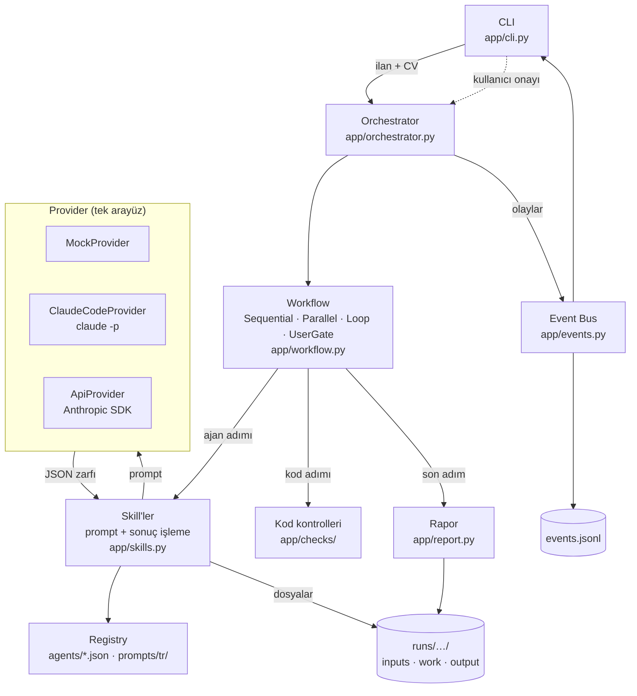

# career-crew

Çok ajanlı iş başvurusu asistanı. Bir iş ilanı ve CV'nizi verirsiniz. Altı yapay zekâ ajanı kendi aralarında konuşarak şunları hazırlar:

- 📄 İlana göre uyarlanmış CV
- 💌 Ön yazı
- 🎤 İlana ve CV'ye özel mülakat hazırlığı
- 📊 Rapor: işveren puanı, ATS skoru (önce/sonra), değişiklikler

Ajanların konuşması terminalde canlı akar. Kim neyi neden değiştirdi, görürsünüz.

## Uydurma yasak

CV'de olmayan deneyim, beceri, unvan, tarih ya da rakam eklenemez. Bu kural üç katmanda denetlenir:

1. **Kanıt alıntısı (kod):** CV Yazarı her maddeyi orijinal CV'den birebir bir alıntıya bağlar. Kod, alıntının orijinal CV'de gerçekten geçtiğini kontrol eder.
2. **Deterministik kontroller (kod):** ilan kelimesi sızıntısı, tarih tutarlılığı, yeni rakamlar, unvan şişirme, yapı ve ATS skoru.
3. **Doğrulayıcı ajan:** kodun yakalayamadığı anlam büyütmelerini yakalar ("yer aldım" → "yönettim"). Kod hatası varken onay veremez.

## Ajanlar

| Ajan | Görev | Model |
|---|---|---|
| 🔎 İlan Analisti | İlandan beceri ve anahtar kelimeleri çıkarır | Sonnet |
| ✍️ CV Yazarı | CV'yi uyarlar, her maddeyi kanıta bağlar | Sonnet |
| 🛡️ Doğrulayıcı | Uydurma olup olmadığına karar verir | Sonnet |
| 👔 İşe Alım Müdürü | 0-100 puan verir, en kritik 3 eksiği söyler | Haiku |
| 💌 Mektup Yazarı | Ön yazı hazırlar | Sonnet |
| 🎤 Mülakatçı | Mülakat soruları ve cevap ipuçları hazırlar | Haiku |

Modeller `agents/*.json` dosyalarından değiştirilebilir. Promptlar `prompts/tr/` altındadır.

## Akış

```
İlan analizi → kullanıcı onayı → CV döngüsü (en fazla 3 tur) → ön yazı → mülakat → rapor
                                  │
                                  ├─ CV Yazarı
                                  ├─ kod kontrolleri
                                  └─ Doğrulayıcı + İşe Alım Müdürü (paralel)
                                  çıkış: uydurma yok VE puan ≥ 80
```

3 turda hedefe ulaşılamazsa en iyi sürüm kullanılır ve rapora uyarı eklenir. Üst üste iki temiz turda puan artmazsa döngü erken durur: kalan eksikler orijinal CV'de olmadığı için yeni tur yalnızca token harcar.

## Mimari



**Temel kararlar:**

- **Ajanlar araç kullanmaz.** İlan, CV ve önceki sürüm prompta doğrudan eklenir. Her ajan tek bir JSON zarfı döndürür: `{"message", "data", "files"}`. Dosyaları ajan değil orchestrator yazar ve her skill yalnızca kendi dosya adlarını yazabilir. Bu yüzden üç mod aynı biçimde çalışır, `claude-code` modunda da ajanların dosya ya da shell erişimi yoktur.
- **Workflow alana bağımlı değildir.** `Sequential`, `Parallel`, `Loop` ve `UserGate` yalnızca bir bağlam nesnesiyle konuşur. Kariyer akışı bu parçalarla [orchestrator.py](app/orchestrator.py) içinde kurulur.
- **Kontroller LLM kullanmaz.** `app/checks/` içindeki her modül saf bir Python fonksiyonudur. Aynı girdiye her zaman aynı sonucu verir.
- **Her şey olay olarak akar.** Terminal çıktısı ve `events.jsonl` aynı Event Bus'tan beslenir. M2'deki web arayüzü aynı olayları SSE ile alacak.

**Görev durumları** (A2A'dan uyarlandı): `submitted → working → completed / rejected / failed / input-required`.

### Modüller

| Yol | Görev |
|---|---|
| `app/cli.py` | Argümanlar, renkli canlı akış, ilan okuma onayı |
| `app/orchestrator.py` | Kariyer akışını kurar, çalıştırma klasörünü açar, en iyi turu seçer |
| `app/workflow.py` | Akış yapı taşları: `Sequential`, `Parallel`, `Loop`, `CodeStep`, `UserGate` |
| `app/skills.py` | Skill başına prompt üretimi, yanıt doğrulama ve durum güncellemesi |
| `app/tasks.py` | `Task`, `Message`, `TextPart`, `FilePart`, `DataPart`, `Artifact` |
| `app/events.py` | Event Bus ve `events.jsonl` kaydı |
| `app/registry.py` | Agent Card'ları ve promptları yükler |
| `app/providers/` | `mock`, `claude_code`, `api` ve ortak JSON zarfı ayrıştırıcısı |
| `app/checks/` | `coverage`, `evidence`, `leakage`, `dates`, `numbers`, `titles`, `structure`, `ats` |
| `app/report.py` | `report.md`: skorlar, turlar, açık sorunlar, değişiklikler |
| `agents/` | 6 Agent Card: model, efor, renk, prompt dosyası |
| `prompts/tr/` | Türkçe rol promptları ve ortak konuşma sözleşmesi |

### Kod kontrolleri

| Kontrol | Düzey | Ne yakalar |
|---|---|---|
| `coverage` | hata | Kanıta bağlanmamış CV maddesi |
| `evidence` | hata | Orijinal CV'de olmayan ya da 3 kelimeden kısa kanıt alıntısı |
| `leakage` | hata | İlanda olup orijinal CV'de olmayan beceri |
| `leakage` (yeni terim) | uyarı | İlanda da orijinal CV'de de olmayan teknoloji adı |
| `dates` | hata | Yeni yıllar, şişirilmiş "N yıl deneyim" |
| `numbers` | hata | Yeni rakam ve yüzdeler |
| `titles` | hata | Eklenen kıdem ya da unvan ifadesi |
| `structure` | uyarı | 2 sayfayı aşan uzunluk, kaybolan bölüm |
| `ats` | skor | İlan anahtar kelimelerinin CV'de geçme oranı |

## Kurulum

Python 3.11 ya da üstü gerekir.

```bash
git clone https://github.com/<kullanici>/career-crew.git
cd career-crew
python3 -m venv .venv
source .venv/bin/activate
pip install -e ".[api,dev]"
```

## Kullanım

Hesap gerektirmeyen demo (sahte CV ve ilan ile):

```bash
career-crew --ilan examples/ilan.md --cv examples/cv.md --mod mock
```

Kendi dosyalarınızla:

```bash
career-crew --ilan ilan.md --cv cv.md --mod api
```

| Seçenek | Açıklama |
|---|---|
| `--ilan` | İş ilanı (`.md` ya da `.txt`) |
| `--cv` | CV (`.md` ya da `.txt`) |
| `--mod` | `mock` (varsayılan), `claude-code` ya da `api` |
| `--runs` | Çalıştırma klasörlerinin yeri (varsayılan `runs/`) |
| `--evet` | İlan okuma onayını sorma |
| `--hizli` | `mock` modunda bekleme yapma |

Her çalıştırma `runs/` altında kendi klasörünü açar:

```
runs/2026-11-21_143000_ilan/
├── inputs/       ilan ve CV kopyası
├── work/         job.json, claims.json, her turun CV'si
├── output/       cv.md, cover_letter.md, interview.md, report.md
└── events.jsonl  tüm konuşma
```

## Modlar

| Mod | Kim için | Maliyet |
|---|---|---|
| `api` | **Önerilen yol.** Kendi Anthropic API anahtarınızla | Kendi API kullanımınız |
| `claude-code` | Kendi Claude Pro/Max aboneliğinizle kişisel kullanım | Ek ücret yok, abonelik limitine tabi |
| `mock` | Demo ve geliştirme | Ücretsiz |

**`api` modu:** `ANTHROPIC_API_KEY` ortam değişkenini ayarlayın ya da `.env.example` dosyasını `.env` olarak kopyalayıp anahtarı yazın. Anahtar koda ya da loglara yazılmaz.

**`claude-code` modu:** Claude Code kurulu ve giriş yapılmış olmalı (`claude` komutunu çalıştırıp `/login`). Ajanlar global ayarlarınız, eklentileriniz, hook'larınız ve MCP sunucularınız olmadan çalışır. Hiçbir araca (dosya, shell) erişimleri yoktur. Ortamda `ANTHROPIC_API_KEY` varsa bu mod onu kaldırır, böylece ücret API'ye değil aboneliğe yansır.

> **Kullanım şartları:** `claude-code` modu, herkesin **kendi** aboneliğiyle **kendi** bilgisayarında kişisel kullanımı içindir. Proje bir hizmet olarak sunulmaz. Claude Code giriş bilgileri asla okunmaz ya da başka bir yere taşınmaz, yalnızca resmî `claude` komutu çağrılır. Bu modu kullananlar Anthropic kullanım şartlarına kendileri uymakla yükümlüdür.

## Gizlilik

- `runs/`, `memory/` ve `.env` `.gitignore`'dadır. Repoda yalnızca **sahte** örnek CV ve ilan vardır.
- Veriler, seçilen model sağlayıcısı dışında hiçbir yere gönderilmez. Analitik ya da izleme yoktur.

## Testler

```bash
pytest
```

Gerçek model çağıran testler (`claude-code` girişi gerekir):

```bash
CAREER_CREW_LIVE=1 pytest -m live
```

## Yol haritası

- **M1:** çekirdek + terminal arayüzü (devam ediyor)
- **M2:** localhost web arayüzü, PDF/fotoğraf girdisi, İngilizce promptlar
- **M3:** hafıza, duraklat/devam et, PDF çıktı
- **M4:** replay modu, demo GIF'i

Tasarım: [KARIYER-EKIBI.md](KARIYER-EKIBI.md)

## Uyarı

Yapay zekâ çıktıları hatalı olabilir. Başvurmadan önce her şeyi kendiniz kontrol edin.

## Lisans

[MIT](LICENSE)
