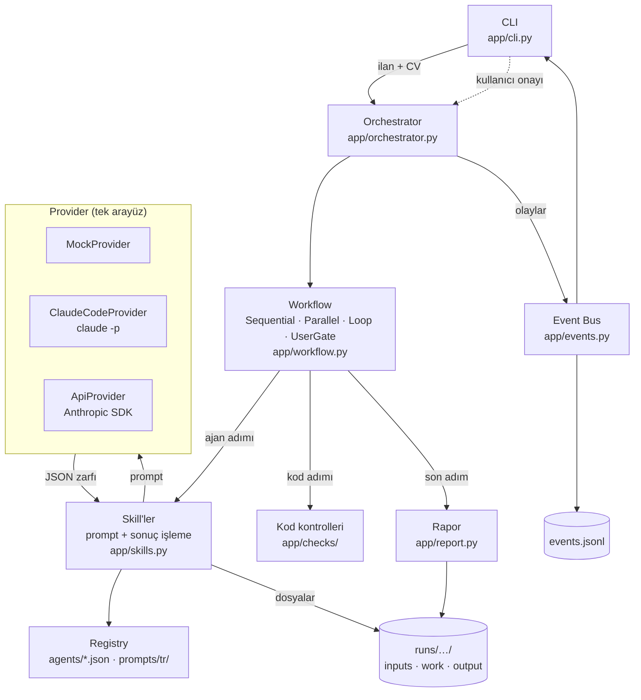

# career-crew

İlana göre CV uyarlayan, ama CV'de olmayan hiçbir şeyi eklemeyen bir iş başvurusu asistanı.

[](https://github.com/burakaydins/career-crew/actions/workflows/tests.yml)  


Kendi iş başvurularım için yazdım. İlanı ve CV'yi veriyorsunuz, altı ajan sırayla çalışıp ilana göre düzenlenmiş bir CV, ön yazı, mülakat hazırlığı ve bir rapor çıkarıyor. Raporda işveren puanı, ATS skorunun önceki ve sonraki hâli, CV'de nelerin değiştiği ve kapanmayan eksikler var. Ajanların birbirine yazdıkları terminalde canlı akıyor, hangi maddenin neden değiştiğini oradan takip edebiliyorsunuz.

## İçindekiler

- [Neden farklı?](#neden-farklı)
- [Hızlı başlangıç](#hızlı-başlangıç)
- [Örnek çalıştırma](#örnek-çalıştırma)
- [Nasıl çalışır?](#nasıl-çalışır)
- [Mimari](#mimari)
- [Modlar](#modlar)
- [Gizlilik](#gizlilik)
- [Geliştirme](#geliştirme)
- [Yol haritası](#yol-haritası)

## Neden farklı?

Yapay zekâya CV uyarlattığınızda ilana uysun diye adayda olmayan beceri, rakam ya da kıdem ekleyebiliyor ([Grounded Optimization, arXiv 2607.01457](https://arxiv.org/abs/2607.01457) bu tür hataları sınıflandırıyor). Mülakatta sorulduğunda da ortaya çıkıyor.

Promptta "uydurma yapma" demek bunu engellemiyor. career-crew'da her CV maddesi orijinal CV'den birebir bir alıntıya bağlanıyor ve bu bağlantıyı model değil kod kontrol ediyor:

| | Yaygın yaklaşım | career-crew |
|---|---|---|
| Uydurmaya karşı | Prompta "uydurma yapma" yazılır, modele güvenilir | Her madde orijinal CV'den bir alıntıya bağlanır. Alıntıyı ve 8 ayrı kuralı kod kontrol eder |
| Son karar | Ajanlar birbirini onaylar | Kod hata bulduysa Doğrulayıcı onay veremez. Verirse kod kararı "ret" olarak değiştirir |
| Eksik beceriler | Eksik anahtar kelimeyi CV'ye eklemek önerilir | Eksik kelime eklenmez. Raporda gerçek eksik olarak yazılır, mülakat hazırlığında nasıl dürüstçe cevaplanacağı anlatılır |
| ATS skoru | Tek bir sayı | Önceki ve sonraki skor, eksik kelimeler ve neden eklenmedikleri |
| Şeffaflık | Sadece sonuç dosyası | Konuşma canlı akar, her turun CV'si `work/` klasöründe kalır, süreç `events.jsonl` dosyasına yazılır |
| Tur sayısı | Sabit sayıda yeniden yazma | Hedefe ulaşınca ya da puan artmayı bırakınca döngü durur |
| Veri | CV bir bulut hizmetine yüklenir | Program kendi bilgisayarınızda çalışır. Veri sadece seçtiğiniz model sağlayıcısına gider, analitik yok |
| Maliyet | Aylık ücretli hizmet | `mock` modu ücretsiz, `claude-code` modu mevcut Claude aboneliğinizle çalışır |

Gerçek bir çalıştırmada ilan Docker istiyordu ve CV'de Docker yoktu. CV Yazarı Docker'ı eklemedi, İşe Alım Müdürü de bu yüzden 62 puan verdi. Ön yazıda Docker deneyimi olmadığı açıkça yazıyordu, mülakat hazırlığında da "Docker kullandınız mı?" sorusu için dürüst bir cevap önerisi vardı.

## Hızlı başlangıç

Python 3.11 ya da üstü gerekiyor.

```bash
git clone https://github.com/burakaydins/career-crew.git
cd career-crew
python3 -m venv .venv
source .venv/bin/activate
pip install -e ".[api,dev]"
```

Hesap gerektirmeyen demo, sahte bir CV ve ilanla:

```bash
career-crew --ilan examples/ilan.md --cv examples/cv.md
```

Kendi dosyalarınızla:

```bash
career-crew --ilan ilan.pdf --cv cv.docx --mod api
```

CV ve ilan `.md`, `.txt`, `.pdf` ya da `.docx` olabilir. PDF ve DOCX'ten çıkarılan metin, ajanların ve kontrollerin tam olarak neyi gördüğü bilinsin diye çalıştırma klasöründe `inputs/cv_metin.md` olarak saklanıyor. Taranmış (resim olarak kaydedilmiş) PDF'ler şimdilik okunamıyor.

| Seçenek | Açıklama |
|---|---|
| `--ilan` | İş ilanı (`.md`, `.txt`, `.pdf`, `.docx`) |
| `--cv` | CV (`.md`, `.txt`, `.pdf`, `.docx`) |
| `--mod` | `mock` (varsayılan), `claude-code` ya da `api` |
| `--runs` | Çalıştırma klasörlerinin yeri (varsayılan `runs/`) |
| `--evet` | İlan okuma onayını sorma |
| `--hizli` | `mock` modunda bekleme yapma |

## Örnek çalıştırma

`mock` modunda CV Yazarı ilk turda bilerek uydurma ekliyor, kontrollerin bunları nasıl yakaladığı görülsün diye:

```
───────────────────────────────── CV turu 1/3 ──────────────────────────────────
✍️ CV Yazarı: CV uyarlandı → output/cv.md. Backend becerileri özete ve beceri
listesinin başına alındı.
🧮 Kod kontrolü: 5 sorun: ATS %30.8 → %38.5
   ✗ Kanıt orijinal CV'de bulunamadı: 'PostgreSQL sorgu optimizasyonunu yönettim.'
   ✗ Kanıt orijinal CV'de bulunamadı: 'Docker ile servisleri paketledim.'
   ✗ 'Docker' ilanda var ama orijinal CV'de yok (sızıntı).
   ✗ '5 yıl' iddiası orijinal CV ile uyuşmuyor (en fazla 3 yıl).
   ✗ '40' rakamı orijinal CV'de yok.
🛡️ Doğrulayıcı: Ret: Docker, %40 ve 5 yıl uydurma. 'Yer aldım' ifadesi
'yönettim' yapılmış.
👔 İşe Alım Müdürü: Puan 72. Uydurmalar mülakatta ortaya çıkar, SQL görünmüyor,
test deneyimi zayıf anlatılmış.
───────────────────────────────── CV turu 2/3 ──────────────────────────────────
✍️ CV Yazarı: Düzeltildi. Docker, %40 ve 'yönettim' çıkarıldı, özet orijinal 3
yıla döndü. SQL, orijinal optimizasyon maddesinden öne çıkarıldı.
🧮 Kod kontrolü: Sorun yok. ATS %30.8 → %38.5
🛡️ Doğrulayıcı: Onay.
👔 İşe Alım Müdürü: Puan 84. Docker ve Kubernetes gerçek eksik, ölçülebilir
sonuç yok.
✓ CV 2. turda hedefe ulaştı.
```

Her çalıştırma `runs/` altında kendi klasörünü açıyor:

```
runs/2026-11-21_143000_ilan/
├── inputs/       ilan ve CV kopyası
├── work/         job.json, claims.json, her turun CV'si
├── output/       cv.md, cover_letter.md, interview.md, report.md
└── events.jsonl  tüm konuşma
```

## Nasıl çalışır?

### Ajanlar

| Ajan | Görev | Model |
|---|---|---|
| 🔎 İlan Analisti | İlandan beceri ve anahtar kelimeleri çıkarır | Sonnet |
| ✍️ CV Yazarı | CV'yi uyarlar, her maddeyi kanıta bağlar | Sonnet |
| 🛡️ Doğrulayıcı | Uydurma olup olmadığına karar verir | Sonnet |
| 👔 İşe Alım Müdürü | 0-100 puan verir, en kritik 3 eksiği söyler | Haiku |
| 💌 Mektup Yazarı | Ön yazı hazırlar | Sonnet |
| 🎤 Mülakatçı | Mülakat soruları ve cevap ipuçları hazırlar | Haiku |

Modeller `agents/*.json` dosyalarından, promptlar `prompts/tr/` altından değiştirilebiliyor. Ajanlara kısa konuşmaları söylendi: en fazla üç cümle, önce karar sonra gerekçe, selamlama ve övgü yok.

### Akış

```
İlan analizi → kullanıcı onayı → CV döngüsü (en fazla 3 tur) → ön yazı → mülakat → rapor
                                  │
                                  ├─ CV Yazarı
                                  ├─ kod kontrolleri
                                  └─ Doğrulayıcı + İşe Alım Müdürü (paralel)
```

Uydurma yoksa ve puan 80'e ulaştıysa döngü biter. Üst üste iki temiz turda puan yükselmediyse de durur, çünkü kalan eksikler orijinal CV'de yok ve yeni bir tur sadece token harcar. Üç tur dolarsa en iyi sürüm kullanılır, rapora da bir uyarı eklenir.

### Uydurma kontrolü

Kontrol üç aşamada yapılıyor. Önce CV Yazarı her maddeyi orijinal CV'den en az üç kelimelik birebir bir alıntıya bağlıyor. Kod, alıntının orijinal CV'de gerçekten geçtiğine ve CV'deki her maddenin bir alıntısı olduğuna bakıyor. Sonra aşağıdaki kurallar çalışıyor. Bunlar düz Python fonksiyonları, LLM kullanmıyorlar ve aynı girdiye hep aynı sonucu veriyorlar. En son Doğrulayıcı ajan, kodun yakalayamayacağı anlam kaymalarına bakıyor; "projede yer aldım" cümlesinin "projeyi yönettim" olması gibi. Kod hata bulduysa Doğrulayıcı onay veremiyor.

| Kontrol | Düzey | Ne yakalar |
|---|---|---|
| `coverage` | hata | Kanıta bağlanmamış CV maddesi |
| `evidence` | hata | Orijinal CV'de olmayan ya da 3 kelimeden kısa kanıt alıntısı |
| `leakage` | hata | İlanda olup orijinal CV'de olmayan beceri |
| `leakage` (yeni terim) | uyarı | İlanda da orijinal CV'de de olmayan teknoloji adı |
| `dates` | hata | Yeni yıllar, şişirilmiş "N yıl deneyim" |
| `numbers` | hata | Yeni rakam ve yüzdeler |
| `titles` | hata | Eklenen kıdem ya da unvan ifadesi |
| `structure` | uyarı | 2 sayfayı aşan uzunluk, kaybolan bölüm |
| `ats` | skor | İlan anahtar kelimelerinin CV'de geçme oranı |

## Mimari



Ajanlara hiç araç vermedim. İlan, CV ve önceki sürüm doğrudan prompta ekleniyor, her ajan da `{"message", "data", "files"}` biçiminde tek bir JSON döndürüyor. Dosyaları ajanlar değil orchestrator yazıyor ve her skill sadece kendi dosya adlarını yazabiliyor. Bu sayede üç mod aynı şekilde çalışıyor ve `claude-code` modunda bile ajanların dosya ya da shell erişimi olmuyor.

Workflow parçaları (`Sequential`, `Parallel`, `Loop`, `UserGate`) iş akışının ne olduğunu bilmiyor, sadece bir bağlam nesnesiyle konuşuyor. Kariyer akışı bu parçalarla [orchestrator.py](app/orchestrator.py) içinde kuruluyor. Terminal çıktısı ve `events.jsonl` aynı Event Bus'tan besleniyor. M2'deki web arayüzü de aynı olayları SSE ile alacak.

Görev durumlarını A2A'dan aldım: `submitted → working → completed / rejected / failed / input-required`.

| Yol | Görev |
|---|---|
| `app/cli.py` | Argümanlar, renkli canlı akış, ilan okuma onayı |
| `app/orchestrator.py` | Kariyer akışını kurar, çalıştırma klasörünü açar, en iyi turu seçer |
| `app/workflow.py` | Akış yapı taşları: `Sequential`, `Parallel`, `Loop`, `CodeStep`, `UserGate` |
| `app/skills.py` | Skill başına prompt üretimi, yanıt doğrulama ve durum güncellemesi |
| `app/tasks.py` | `Task`, `Message`, `TextPart`, `FilePart`, `DataPart`, `Artifact` |
| `app/events.py` | Event Bus ve `events.jsonl` kaydı |
| `app/registry.py` | Agent Card'ları ve promptları yükler |
| `app/providers/` | `mock`, `claude_code`, `api` ve ortak JSON zarfı ayrıştırıcısı |
| `app/checks/` | `coverage`, `evidence`, `leakage`, `dates`, `numbers`, `titles`, `structure`, `ats` |
| `app/report.py` | `report.md`: skorlar, turlar, açık sorunlar, değişiklikler |
| `agents/` | 6 Agent Card: model, efor, renk, prompt dosyası |
| `prompts/tr/` | Türkçe rol promptları ve ortak konuşma sözleşmesi |

## Modlar

| Mod | Kim için | Maliyet |
|---|---|---|
| `api` | Claude aboneliği olmayanlar için, kendi Anthropic API anahtarınızla | Kendi API kullanımınız |
| `claude-code` | Kendi Claude Pro/Max aboneliğinizle kişisel kullanım | Ek ücret yok, abonelik limitine tabi |
| `mock` | Demo ve geliştirme | Ücretsiz |

`api` modu için `ANTHROPIC_API_KEY` ortam değişkenini ayarlayın ya da `.env.example` dosyasını `.env` adıyla kopyalayıp anahtarı içine yazın. Anahtar koda ya da loglara yazılmıyor. Bu modu kendi işim için kullanmadığımdan gerçek API ile henüz çalıştırmadım. İstek biçimi ve hata yönetimi sahte bir istemciyle test ediliyor, ama bir sorun çıkarsa issue açarsanız sevinirim.

`claude-code` modu için Claude Code kurulu olmalı ve `claude auth login` ile giriş yapılmış olmalı. Ajanlar sizin global ayarlarınızı, eklentilerinizi, hook'larınızı ve MCP sunucularınızı yüklemeden çalışıyor, hiçbir araca da erişemiyor. Ortamda `ANTHROPIC_API_KEY` tanımlıysa bu mod onu kaldırıyor, böylece ücret API'ye değil aboneliğe yansıyor. Benim denememde bir çalıştırma iki dakika kadar sürdü.

> Kullanım şartları: `claude-code` modu herkesin kendi aboneliğiyle, kendi bilgisayarında kişisel kullanımı için var. Proje bir hizmet olarak sunulmuyor. Claude Code giriş bilgileri okunmuyor ya da başka bir yere taşınmıyor, sadece resmî `claude` komutu çağrılıyor. Bu modu kullananlar Anthropic kullanım şartlarına uymaktan kendileri sorumlu.

## Gizlilik

`runs/`, `memory/` ve `.env` `.gitignore`'da. Repodaki örnek CV ve ilan sahte. Veriler seçilen model sağlayıcısı dışında bir yere gönderilmiyor, analitik ya da izleme yok.

## Geliştirme

```bash
pytest
```

Gerçek model çağıran testler için `claude-code` girişi gerekiyor:

```bash
CAREER_CREW_LIVE=1 pytest -m live
```

Bu testler ajan çağrısının kullanıcı eklentilerini ve MCP sunucularını yüklemediğine ve hiçbir araca erişmediğine bakıyor.

README'deki GIF `mock` çalıştırmasından üretiliyor (macOS, Pillow gerekir):

```bash
python scripts/make_demo_gif.py docs/demo.gif
```

Tasarım notları [KARIYER-EKIBI.md](KARIYER-EKIBI.md) dosyasında.

## Yol haritası

- [x] M1: çekirdek, terminal arayüzü, uydurma kontrolleri
- [x] PDF ve DOCX girdisi
- [ ] M2: localhost web arayüzü, fotoğraf ve taranmış PDF girdisi, İngilizce promptlar
- [ ] M3: hafıza, duraklatıp devam etme, PDF çıktı
- [ ] M4: replay modu

## Esinlenmeler

| Kaynak | Ne aldım |
|---|---|
| [DeepLearning.AI: Multi AI Agent Systems with crewAI](https://learn.deeplearning.ai/courses/multi-ai-agent-systems-with-crewai/lesson/a8ecj/build-a-crew-to-tailor-job-applications) | İş başvurusu ekibindeki roller |
| [Grounded Optimization, arXiv 2607.01457](https://arxiv.org/abs/2607.01457) (Indukuri ve Agrawal) | Katmanlı doğrulama fikri: tarih kontrolü, kodla sızıntı tespiti, yapı kontrolü ve değerlendirici ajan |
| [Hirepanel](https://github.com/punit2911/Hirepanel) | CV tarayan bu araçtaki "alıntı yoksa puan da yok" kuralı. Burada aynı kuralı CV'yi yazan tarafa uyguladım |
| Yusuf Baykaloğlu, *Çoklu-Ajan Sistemleri: A2A Protokolü ile AI Agent Orkestrasyonu* | Agent Card, görev durumları, Message/Part yapısı, workflow desenleri, Event Bus |

## Uyarı

Yapay zekâ çıktıları hatalı olabilir. Başvurmadan önce her şeyi kendiniz okuyun.

## Lisans

[MIT](LICENSE)
